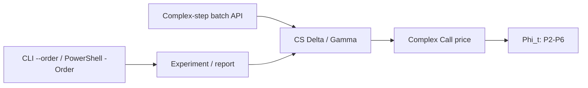

# Quant Black–Scholes Greeks — v1.0.0

Python/NumPy and C++17 library for European call pricing, analytic Delta/Gamma, finite differences, and complex-step differentiation. Includes validated batch APIs, shared high-precision fixtures, error plots, and throughput experiments. The complex CDF defaults to **P3**, configurable per call with orders **2–6**.

The current integration methods are **Python imports and C++ linking**. HTTP endpoints, Python/C++ bindings, and a pip-installable package are future work.

## v1 scope

| Available | Planned |
| --- | --- |
| European Call; continuous dividend yield `q` | Put and put-call parity |
| Analytic price, Delta, Gamma | Vega, Theta, Rho |
| NumPy broadcasting and C++ batch facade | Implied-volatility solver |
| Complex-step CDF P2–P6, default P3 | American exercise and discrete dividends |
| C++ serial and analytic `ParUnseq` backend | Explicit SIMD backend and Python bindings |
| Shared fixtures, automatic test report, numerical/performance studies | Market-data adapters, volatility surfaces, hosted API |

See [release notes](docs/releases/v1.0.0.md), [API details](docs/complex_step_api.md), and the [test report](docs/test_status.md).

## Quick start

Run commands from the repository root. Python 3.10+ and a C++17 compiler are required for their respective implementations; C++ builds use CMake 3.15+.

```powershell
python -m pip install -r Python_prototype/requirements.txt
python -X utf8 experiments/assignment/black_scholes_sweep.py --order 3
./Run_tests.ps1 -Order 3
```

Dependencies specify major-version ranges, not a frozen environment; not every version combination has been tested. Recorded runs use Python 3.14.4, NumPy 2.4.6 and SciPy 1.18. Independent reference generation and the high-precision CDF study additionally require `python -m pip install mpmath`.

For MSVC, `./Make_cpp.ps1 -Order 3` loads the Visual Studio development environment, builds, runs tests/reporting, then executes the C++ sweep and plots its CSVs. It stops if a test fails or cannot start. Manual build:

```powershell
cmake -S BS_cpp -B out/bs_cpp
cmake --build out/bs_cpp --config Release
ctest --test-dir out/bs_cpp -C Release --output-on-failure
```

The sweep executable is `out/bs_cpp/Release/bs_greeks_test.exe` with a multi-config generator, or `out/bs_cpp/bs_greeks_test.exe` with a single-config Windows build. It accepts `--order 5`. On other platforms use the corresponding executable without `.exe` where appropriate.

## API contract and units

All pricing functions use input order **`S, K, r, q, sigma, T`**:

| Input | Meaning / unit |
| --- | --- |
| `S`, `K` | Current spot and strike, in the same currency and contract basis |
| `r` | Annual continuously compounded risk-free rate, decimal |
| `q` | Annual continuous dividend yield, decimal |
| `sigma` | Annualized volatility, decimal: `0.20` means 20% |
| `T` | Time remaining to expiry, in years |
| `h` | Absolute spot perturbation; relative step is `h_rel=h/S` |
| `order` | Highest retained imaginary CDF Taylor power, integer 2–6 |

Validated batch facades require finite inputs, `S,K>0`, and `sigma,T>=0`. They return `CallResult(price, delta, gamma)`: price is per underlying unit, Delta is `dC/dS`, Gamma is `d²C/dS²`. The caller applies contract multiplier and position size.

At `sigma=0` or `T=0`, batch facades use discounted forward intrinsic value, Gamma zero, and midpoint Delta at the intrinsic kink. The midpoint is a library convention; a classical derivative does not exist at that kink. Python preserves broadcast shape, including `()` for scalars and empty arrays; C++ requires six equally sized vectors. Invalid inputs raise `ValueError`/`std::invalid_argument`, and nonfinite results raise overflow errors. Python shape/type failures may additionally raise `TypeError` or broadcasting `ValueError`. Legacy scalar kernels have their own guards: use the validated facade at a system boundary.

## Python API

Modules currently live in `Python_prototype/`. Add this directory to the consuming application's import path; no package installation step is implemented yet.

```python
from pathlib import Path
import sys
import numpy as np

# Run this example from the repository root.
sys.path.insert(0, str(Path("Python_prototype").resolve()))
from bs_batch import evaluate_call, evaluate_call_complex_step
from black_scholes import gamma_45_deg

# Analytic batch for ordinary price/risk calculations.
result = evaluate_call(
    S=np.array([90., 100., 110.]), K=100.,
    r=.03, q=.01, sigma=.20, T=1.,
)
print(result.price, result.delta, result.gamma)

# Numerical derivative diagnostic, with a per-call CDF order.
check = evaluate_call_complex_step(
    [90., 100., 110.], 100., .03, .01, .20, 1., h=.2, order=3,
)
gamma_p5 = gamma_45_deg(100., 100., .03, .01, .20, 1., h=.2, order=5)
```

| Layer | Signature / exports |
| --- | --- |
| Analytic batch | `evaluate_call(S,K,r,q,sigma,T) -> CallResult` |
| Complex-step batch | `evaluate_call_complex_step(S,K,r,q,sigma,T, *, h=1e-5, order=3) -> CallResult` |
| Analytic kernels | `bs_price_call(...)`, `delta_call(...)`, `Gamma(...)` |
| Complex CDF | `Phi_t(z, *, order=3)` |
| Real/complex price | `bs_price_call_t(..., eps=1e-12, *, order=3)` |
| CS Delta | `delta_cs(..., h=1e-20, *, order=3)` |
| CS Gamma | `gamma_cs_real(..., h=1e-5, *, order=3)`, `gamma_45_deg(..., h=1e-5, *, order=3)` |
| FD diagnostics | `delta_forward(..., h=1e-5)`, `gamma_forward(..., h=1e-5)` |

Here `...` means the six pricing inputs in the stated order. Python `order` is keyword-only; older positional `h`/`eps` calls remain compatible. It accepts Python/NumPy integers and rejects booleans, floats, arrays and out-of-range values. Analytic batch does not need `order`.

Complex-step batch returns analytic real price, CS Delta and 45° CS Gamma. Positive finite `h` broadcasts to the input shape. The example `.2` is not a universal step setting: `order` does not tune `h`, and Gamma's default `h=1e-5` can be too small in some regimes. Python complex pricing retains its guard against `sigma*sqrt(T)` close to zero.

## C++ API and linking

Public functions use namespace `black_scholes`:

| Header | API |
| --- | --- |
| `black_scholes.h` | Analytic scalar/vector price, Delta, Gamma; `*_par` and FD diagnostics |
| `bs_batch.h` | `CallInputs`, `CallResult`, `BatchBackend`, validated batch facades |
| `complex_step.h` | `Phi_t`, `bs_price_call_complex`, `delta_complex_step`, `gamma_cs_real`, `gamma_45_deg` |

Link the CMake target `black_scholes_core`. A consuming CMake project can use `add_subdirectory(path/to/Quant_interview/BS_cpp quant_bs_build EXCLUDE_FROM_ALL)` and `target_link_libraries(your_app PRIVATE black_scholes_core)`; the target exports its header directory. Enable C++17 or newer in the consuming project.

```cpp
#include "bs_batch.h"
#include "complex_step.h"
#include <iostream>
#include <vector>

int main() {
    using namespace black_scholes;
    std::vector<double> S{90,100,110}, K(3,100), r(3,.03), q(3,.01);
    std::vector<double> sigma(3,.20), T(3,1.);
    CallInputs input{S,K,r,q,sigma,T}; // References: keep these vectors alive.
    auto analytic = evaluate_call(input, BatchBackend::Serial);
    auto diagnostic = evaluate_call_complex_step(input, .2, 5);
    std::cout << analytic.price[1] << " " << diagnostic.gamma[1] << "\n";
}
```

Analytic batch accepts `BatchBackend::Serial` (default) or `ParUnseq`. Complex-step batch is currently serial; it accepts a positive finite scalar `h` or an equal-length step vector, followed by `int order=3`. Scalar complex Greeks take `h`, then `order`, as their final arguments. See the [full signatures and propagation](docs/complex_step_api.md).

## CDF parameter propagation and numerical meaning



Every layer forwards the selected order explicitly, with no mutable global configuration. The full CDF is entire; P2–P6 are local truncations for small imaginary parts. P2 generally gives second-order local 45° Gamma error, and P3–P6 generally give fourth-order local error before roundoff dominates. P6 does not turn this stencil into a sixth-order derivative method.

Follow the paper-and-pencil derivation from Gaussian density through erf/erfc, both Hermite conventions and complex Taylor expansion in [the mathematical report](docs/complex_cdf_series.md).

## Connecting a market research platform

A data adapter can read Jerry's aligned option-chain/underlying snapshots, convert columns to NumPy arrays, call `evaluate_call`, and write model prices and Greeks to a feature table. The caller supplies time/expiry conventions, rates, dividends, volatility estimates, quote timestamps and contract multipliers. Spot and strike must match the same contract basis after corporate actions.

Retain bid/ask as well as mid: a mid-price residual is not an executable trade price. Use a volatility estimate independent of the target quote for a model-price comparison. An IV inferred from that same quote reproduces it on repricing; the IV solver is planned, not available in v1.

Individual US equity options use American exercise, while this engine prices European Calls with continuous dividends. General use on those contracts requires model selection and an American/discrete-dividend engine. See [OIC exercise conventions](https://www.optionseducation.org/referencelibrary/faq/options-exercise). Volatility surfaces, skew features and event studies are downstream research work.

## Tests, reporting and performance

```powershell
python -m unittest discover -s tests -v
./Run_tests.ps1 -Order 3
./Run_tests.ps1 -SkipCpp -Order 5
python scripts/update_test_report.py --build-dir out/bs_cpp --config Release --order 3
```

The last command tests an existing build. `-SkipCpp` produces an explicitly marked Python-only report. Report generation refreshes the function inventory, associations, outcomes, diagnostics, error tables/plots and CSV/JSON metadata. Maintain test associations and roadmap in `scripts/test_report_registry.json`. Correctness tests cover all five CDF orders regardless of the report-curve selection.

**Recorded v1 verification:** 18 Python tests passed. In the latest recorded C++ run, `complex_cdf_order` and `gamma_edge` passed; Windows Application Control blocked `bs_batch_contract` and `normal_cdf` from starting (error 4551). Batch contract passed in the preceding run. Both P5 assignment entry points completed. This is partial local verification, not an all-green C++ or CI claim; see [raw evidence and plots](docs/test_status.md).

Shared golden CSVs use independent 80-digit mpmath references. Other sweep plots compare with the library's analytic formula: they are diagnostics, not proof of zero error over the whole domain. Extremely small steps can be unresolvable; FD Gamma and real-part CS Gamma suffer cancellation. Prefer analytic Greeks for ordinary pricing/risk calculations and numerical methods for cross-checks.

```powershell
python benchmarks/benchmark_python.py --sizes 256 4096 32768 262144 --repeats 7 --workers 2 4
python benchmarks/benchmark_cdf_orders.py --repeats 15
cmake -S BS_cpp -B out/bs_benchmark -DBS_BUILD_BENCHMARKS=ON
cmake --build out/bs_benchmark --config Release
```

NumPy vectorization does not guarantee multicore execution. C++ `par_unseq` permits parallel/unsequenced execution but guarantees neither worker count nor SIMD instructions. See [batch/SIMD methodology](docs/batch_testing_and_simd.md) and [CDF-order timings](docs/cdf_performance.md). The latter preserves historical measurements taken before the P3 default switch.

## Repository and outputs

| Path | Responsibility |
| --- | --- |
| `Python_prototype/` | Python kernels, batch API, compatibility script wrappers |
| `BS_cpp/` | C++ public headers/core, tests, sweep, optional benchmark |
| `experiments/assignment/` | Canonical Python sweeps and plotting |
| `experiments/complex_cdf/` | Independent high-precision CDF-order study |
| `tests/`, `testdata/` | Python tests and shared golden fixtures/generators |
| `benchmarks/` | Python throughput and CDF-order measurements |
| `scripts/` | Automatic test reporting and registry |
| `docs/` | API, derivations, test/performance reports, release notes |
| `notebooks/` | CAPM/covariance notebooks with local data and images |
| `artifacts/` | Versioned experiment plots, CSVs and evidence |
| `out/` | Ignored local builds and temporary output |

New assignment outputs use `artifacts/assignment/{python,cpp}/p{order}/<slug>/`. Historical directories without `p{order}` are preserved. Assignment CSV schema remains:

```text
h_rel,h,Delta_analytic,Delta_fd,Delta_cs,err_D_fd,err_D_cs,
Gamma_analytic,Gamma_fd,Gamma_cs_real,Gamma_cs_45,err_G_fd,err_G_cs_real,err_G_cs_45
```

The actual header is one line; it is wrapped here for readability. Plot C++ CSVs with `python -X utf8 experiments/assignment/plot_cpp_results.py`. Other evidence lives in `artifacts/test-report/`, `artifacts/complex-cdf/` and `artifacts/cdf-performance/`. See the [repository map](docs/repository_structure.md).
