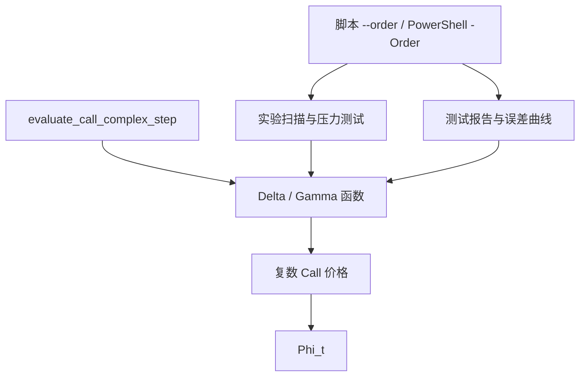

# 复数 CDF 阶数 API：默认 P3

Python 和 C++ 的复数 CDF 现在默认使用 **P3**，每次调用可选择 `order=2,3,4,5,6`。`order` 表示 CDF 按虚部 $b$ 展开保留到 $b^{order}$；它不是 Greek 的收敛阶数。45° Gamma 的 P2 一般为二阶，P3–P6 在局部适用区间一般为四阶，增加到 P6 不会把当前求导公式变成六阶。

## 参数如何逐层传递



每一层都显式把所选 `order` 传给下一层。阶数按调用设置，可以在同一进程中交替使用 P2/P3/P5，没有全局可变配置。

| 层 | Python API | C++ API |
| --- | --- | --- |
| CDF | `Phi_t(z, *, order=3)` | `Phi_t(z, int order=3)` |
| 复数定价 | `bs_price_call_t(..., eps=1e-12, *, order=3)` | `bs_price_call_complex(..., int order=3)` |
| Delta | `delta_cs(..., h=1e-20, *, order=3)` | `delta_complex_step(..., double h=1e-20, int order=3)` |
| Gamma 实部 | `gamma_cs_real(..., h=1e-5, *, order=3)` | `gamma_cs_real(..., double h=1e-5, int order=3)` |
| Gamma 45° | `gamma_45_deg(..., h=1e-5, *, order=3)` | `gamma_45_deg(..., double h=1e-5, int order=3)` |
| 批量 | `evaluate_call_complex_step(..., *, h=1e-5, order=3)` | `evaluate_call_complex_step(input, h, int order=3)` |

Python 新参数只能按关键字传入，旧的 `h` / `eps` 位置参数仍兼容；旧别名与导出入口同步支持该参数。Python 接受普通整数和 NumPy 整数，拒绝布尔、浮点数、数组及范围外阶数；C++ 的整数阶数要求在 2–6 范围内。

## Python 示例

从仓库根目录运行：

```python
import sys
sys.path.insert(0, "Python_prototype")
from black_scholes import gamma_45_deg
from bs_batch import evaluate_call_complex_step

args = (100., 100., 0., 0., .2, 1.)  # S, K, r, q, sigma, T
default_gamma = gamma_45_deg(*args, h=.2)  # 默认 P3
legacy_gamma = gamma_45_deg(*args, h=.2, order=2)
p5_gamma = gamma_45_deg(*args, h=.2, order=5)
result = evaluate_call_complex_step([90., 100., 110.], 100., 0., 0., .2, 1.,
                                    h=[.1, .2, .3], order=3)
print(result.price, result.delta, result.gamma)
```

批量接口的价格使用实数解析公式，Delta 使用复数步长，Gamma 使用 45° 公式。Python 的输入与 `h` 按 NumPy 规则广播；C++ 六个输入 vector 等长，`h` 可为统一标量或等长 vector。`sigma=0` 或 `T=0` 保留批量解析接口的退化约定。

`h` 是绝对 Spot 步长，阶数不会自动调整步长。示例中的 `.2` 适用于该 ATM 演示，不能作为所有参数区间的统一值。Python 原复数价格函数仍拒绝 `sigma*sqrt(T)` 接近零的输入。

## C++ 示例

```cpp
#include "complex_step.h"
#include "bs_batch.h"
using namespace black_scholes;
double gamma = gamma_45_deg(100, 100, 0, 0, .2, 1, .2, 5);
std::vector<double> S{90, 100, 110}, K(3, 100), r(3, 0), q(3, 0);
std::vector<double> sigma(3, .2), T(3, 1);
CallInputs inputs{S, K, r, q, sigma, T};
auto batch = evaluate_call_complex_step(inputs, .2, 3);
```

公共实现位于 `BS_cpp/complex_step.h/.cpp`，C++ 实验入口复用这份实现。C++ 复数 CDF 同时移除了旧实验代码把极小虚部直接截为零的分支；因此极小步长 Delta 的 P2 也不会复现该旧缺陷。新复数批量接口当前为串行计算。

## 脚本与产物

```powershell
python experiments/assignment/black_scholes_sweep.py --order 5
./Make_cpp.ps1 -Order 5
./Run_tests.ps1 -Order 3
python scripts/update_test_report.py --build-dir out/test-report --order 3
```

以上入口省略参数都选择 P3。C++ 实验可直接运行 `out/test-report/bs_greeks_test.exe --order 5`。新实验产物写入 `artifacts/assignment/python/p5/<slug>/` 或 `artifacts/assignment/cpp/p5/<slug>/`，保留原作业 CSV 列结构；已有历史目录保留。报告 JSON 与曲线 CSV 记录 `cdf_order`，报告标题/方法标签显示所选 P 阶数。正确性测试始终覆盖全部五种阶数，`-Order` 只选择本次报告和实验所用阶数。

解析 `evaluate_call` / `Gamma` 使用实数公式，不需要该参数。P3 是复数计算路径的生产默认值；解析 Gamma 继续作为定价与误差比较的基准。

## 验证入口

- `testdata/complex_cdf_golden.csv`：独立 80 位 Hermite 展开生成，包含五种阶数共 20 个参考点。
- `tests/test_complex_cdf_order.py`：系数、默认值、逐层参数传递、旧位置参数、广播、非法阶数及局部收敛率。
- `BS_cpp/tests/complex_cdf_order_test.cpp`：同一份参考数据、公共 C++ API、批量传递、极小步长 Delta 及边界验证。
- 最新运行状态与误差曲线见 [自动测试报告](test_status.md)。
