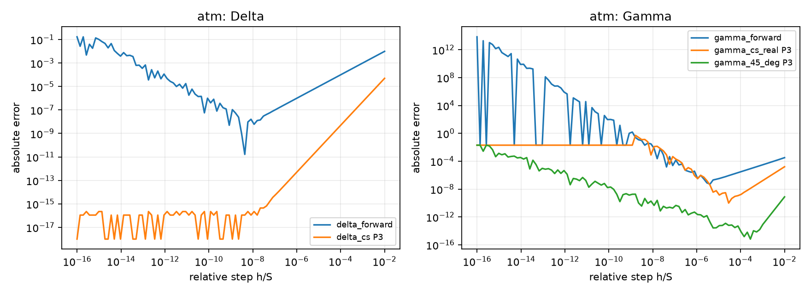
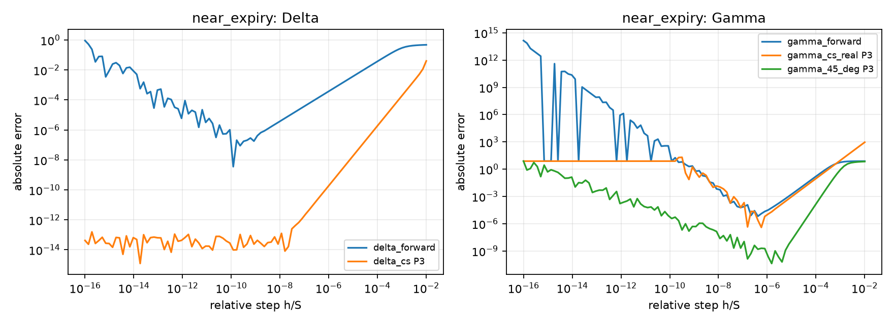

# 自动测试与开发进度报告

生成时间：2026-10-03T14:06:15.432754+00:00；commit：`54328eaf7d47c237b132376c42dcc07a87c52f0d`；工作区有改动：True。
运行环境：`C:\Python314\python.exe`；Python `3.14.4`；`Windows-11-10.0.26300-SP0`。

本次误差扫描的 CDF 阶数：**P3**；默认 P3。测试套件会独立验证全部支持阶数，不随扫描参数改变。

由 `scripts/update_test_report.py` 生成，请修改实现、测试或 `scripts/test_report_registry.json` 后重新运行，勿手改本文件。
`tests/test_*.py` 与已注册的 CTest 测试会自动发现。函数扫描范围为 registry 的 sources 列表。函数与测试的关联由 registry 明确维护；检测到函数定义只表示已有实现入口，不证明实现完整。C++ 同名重载合并显示，关联测试不保证覆盖所有重载。

## 函数实现与验证

符号：$\Delta$ 为 Delta，$\Gamma$ 为 Gamma；$C$ 为 Call 价格，$\Phi$ / $\phi$ 为标准正态分布函数 / 密度函数。辅助函数标为 —。

| Greeks | 函数 | 相对路径 | 实现状态 | 本次关联测试 |
| --- | --- | --- | --- | --- |
| $\Phi$ | `Phi_real` | [Python_prototype/black_scholes.py](../Python_prototype/black_scholes.py) | 检测到定义 | 未验证 / 待补关联测试 |
| $\phi$ | `phi` | [Python_prototype/black_scholes.py](../Python_prototype/black_scholes.py) | 检测到定义 | 未验证 / 待补关联测试 |
| $\Delta$ | `delta_call` | [Python_prototype/black_scholes.py](../Python_prototype/black_scholes.py) | 检测到定义 | PASS |
| $\Gamma$ | `Gamma` | [Python_prototype/black_scholes.py](../Python_prototype/black_scholes.py) | 检测到定义 | PASS |
| $\Gamma$ | `gamma_ref` | [Python_prototype/black_scholes.py](../Python_prototype/black_scholes.py) | 检测到定义 | 未验证 / 待补关联测试 |
| $C$ | `bs_price_call` | [Python_prototype/black_scholes.py](../Python_prototype/black_scholes.py) | 检测到定义 | PASS |
| $\Delta$ | `delta_forward` | [Python_prototype/black_scholes.py](../Python_prototype/black_scholes.py) | 检测到定义 | PASS |
| $\Gamma$ | `gamma_forward` | [Python_prototype/black_scholes.py](../Python_prototype/black_scholes.py) | 检测到定义 | PASS |
| $\Phi$ | `Phi_t` | [Python_prototype/black_scholes.py](../Python_prototype/black_scholes.py) | 检测到定义 | PASS |
| $C$ | `bs_price_call_t` | [Python_prototype/black_scholes.py](../Python_prototype/black_scholes.py) | 检测到定义 | PASS |
| $\Delta$ | `delta_cs` | [Python_prototype/black_scholes.py](../Python_prototype/black_scholes.py) | 检测到定义 | PASS |
| $\Gamma$ | `gamma_cs_real` | [Python_prototype/black_scholes.py](../Python_prototype/black_scholes.py) | 检测到定义 | PASS |
| $\Gamma$ | `gamma_45_deg` | [Python_prototype/black_scholes.py](../Python_prototype/black_scholes.py) | 检测到定义 | PASS |
| $C,\;\Delta,\;\Gamma$ | `evaluate_call` | [Python_prototype/bs_batch.py](../Python_prototype/bs_batch.py) | 检测到定义 | PASS |
| $C,\;\Delta,\;\Gamma$ | `evaluate_call_complex_step` | [Python_prototype/bs_batch.py](../Python_prototype/bs_batch.py) | 检测到定义 | PASS |
| $\Gamma$ | `Gamma` | [BS_cpp/black_scholes.cpp](../BS_cpp/black_scholes.cpp) | 检测到定义 | BLOCKED, PASS |
| $\Gamma$ | `Gamma_par` | [BS_cpp/black_scholes.cpp](../BS_cpp/black_scholes.cpp) | 检测到定义 | BLOCKED |
| $\Phi$ | `Phi_real` | [BS_cpp/black_scholes.cpp](../BS_cpp/black_scholes.cpp) | 检测到定义 | BLOCKED |
| $\Phi$ | `Phi_real_par` | [BS_cpp/black_scholes.cpp](../BS_cpp/black_scholes.cpp) | 检测到定义 | 未验证 / 待补关联测试 |
| $C$ | `bs_price_call` | [BS_cpp/black_scholes.cpp](../BS_cpp/black_scholes.cpp) | 检测到定义 | BLOCKED |
| $C$ | `bs_price_call_par` | [BS_cpp/black_scholes.cpp](../BS_cpp/black_scholes.cpp) | 检测到定义 | BLOCKED |
| $\Delta$ | `delta_call` | [BS_cpp/black_scholes.cpp](../BS_cpp/black_scholes.cpp) | 检测到定义 | BLOCKED |
| $\Delta$ | `delta_call_par` | [BS_cpp/black_scholes.cpp](../BS_cpp/black_scholes.cpp) | 检测到定义 | BLOCKED |
| $\Delta$ | `delta_forward` | [BS_cpp/black_scholes.cpp](../BS_cpp/black_scholes.cpp) | 检测到定义 | 未验证 / 待补关联测试 |
| $\Delta$ | `delta_forward_par` | [BS_cpp/black_scholes.cpp](../BS_cpp/black_scholes.cpp) | 检测到定义 | 未验证 / 待补关联测试 |
| $\Gamma$ | `gamma_forward` | [BS_cpp/black_scholes.cpp](../BS_cpp/black_scholes.cpp) | 检测到定义 | 未验证 / 待补关联测试 |
| $\Gamma$ | `gamma_forward_par` | [BS_cpp/black_scholes.cpp](../BS_cpp/black_scholes.cpp) | 检测到定义 | 未验证 / 待补关联测试 |
| $C,\;\Delta,\;\Gamma$ | `evaluate_call` | [BS_cpp/bs_batch.cpp](../BS_cpp/bs_batch.cpp) | 检测到定义 | BLOCKED |
| $C,\;\Delta,\;\Gamma$ | `evaluate_call_complex_step` | [BS_cpp/bs_batch.cpp](../BS_cpp/bs_batch.cpp) | 检测到定义 | PASS |
| — | `validate` | [BS_cpp/bs_batch.cpp](../BS_cpp/bs_batch.cpp) | 检测到定义 | 未验证 / 待补关联测试 |
| $\Phi$ | `Phi_t` | [BS_cpp/complex_step.cpp](../BS_cpp/complex_step.cpp) | 检测到定义 | PASS |
| $C$ | `bs_price_call_complex` | [BS_cpp/complex_step.cpp](../BS_cpp/complex_step.cpp) | 检测到定义 | PASS |
| $\Delta$ | `delta_complex_step` | [BS_cpp/complex_step.cpp](../BS_cpp/complex_step.cpp) | 检测到定义 | PASS |
| — | `finite_result` | [BS_cpp/complex_step.cpp](../BS_cpp/complex_step.cpp) | 检测到定义 | 未验证 / 待补关联测试 |
| $\Gamma$ | `gamma_45_deg` | [BS_cpp/complex_step.cpp](../BS_cpp/complex_step.cpp) | 检测到定义 | PASS |
| $\Gamma$ | `gamma_cs_real` | [BS_cpp/complex_step.cpp](../BS_cpp/complex_step.cpp) | 检测到定义 | PASS |
| — | `validate_order` | [BS_cpp/complex_step.cpp](../BS_cpp/complex_step.cpp) | 检测到定义 | 未验证 / 待补关联测试 |
| — | `validate_step` | [BS_cpp/complex_step.cpp](../BS_cpp/complex_step.cpp) | 检测到定义 | 未验证 / 待补关联测试 |

## 待完成事项（人工维护的范围）

| 工作 | 从哪个相对路径继续 | 下一步 |
| --- | --- | --- |
| Put 定价与 put-call parity | [Python_prototype/black_scholes.py](../Python_prototype/black_scholes.py) | 增加 Put 与恒等式测试 |
| Vega / Theta / Rho | [Python_prototype/black_scholes.py](../Python_prototype/black_scholes.py) | 增加解析公式、单位约定与差分检验 |
| IV 求解器 | [Python_prototype/bs_batch.py](../Python_prototype/bs_batch.py) | 增加无套利界、低 Vega、失败状态与价格往返测试 |
| 显式 SIMD 后端 | [BS_cpp/bs_batch.cpp](../BS_cpp/bs_batch.cpp) | 实现后端；复用 golden 测试并取得向量化证据 |
| 并行效率验收 | [benchmarks/benchmark_python.py](../benchmarks/benchmark_python.py) | 记录硬件、线程数、吞吐与 speedup；当前报告不运行基准 |

## 本次全部测试

PASS=满足当前断言；FAIL=断言失败；ERROR=运行错误；BLOCKED=进程未启动；SKIP/XFAIL 均不算通过。

| 测试 ID | 结果 |
| --- | --- |
| `test_bs_batch.BatchContractTests.test_degenerate_midpoint_convention` | PASS |
| `test_bs_batch.BatchContractTests.test_empty_and_input_immutability` | PASS |
| `test_bs_batch.BatchContractTests.test_golden_cases` | PASS |
| `test_bs_batch.BatchContractTests.test_invalid_inputs` | PASS |
| `test_bs_batch.BatchContractTests.test_metamorphic_properties` | PASS |
| `test_bs_batch.BatchContractTests.test_scalar_and_broadcast_shapes` | PASS |
| `test_complex_cdf_order.ComplexCdfOrderTests.test_batch_scalar_broadcast_steps_and_degenerate` | PASS |
| `test_complex_cdf_order.ComplexCdfOrderTests.test_default_p3_and_legacy_exports` | PASS |
| `test_complex_cdf_order.ComplexCdfOrderTests.test_golden_coefficients_all_orders` | PASS |
| `test_complex_cdf_order.ComplexCdfOrderTests.test_greeks_forward_order_through_price_to_cdf` | PASS |
| `test_complex_cdf_order.ComplexCdfOrderTests.test_invalid_order_at_every_layer` | PASS |
| `test_complex_cdf_order.ComplexCdfOrderTests.test_local_second_vs_fourth_order` | PASS |
| `test_complex_cdf_order.ComplexCdfOrderTests.test_real_inputs_empty_arrays_and_np_integer` | PASS |
| `test_complex_cdf_order.ComplexCdfOrderTests.test_sweep_forwarding_and_positional_compatibility` | PASS |
| `test_numerical_accuracy.NumericalAccuracyTests.test_delta_methods_at_resolvable_step` | PASS |
| `test_numerical_accuracy.NumericalAccuracyTests.test_forward_gamma_at_resolvable_step` | PASS |
| `test_numerical_accuracy.NumericalAccuracyTests.test_tiny_fd_step_is_unresolvable` | PASS |
| `test_numerical_accuracy.NumericalAccuracyTests.test_truncated_complex_cdf_changes_45_degree_order` | PASS |
| `cpp:complex_cdf_order` | PASS |
| `cpp:bs_batch_contract` | BLOCKED |
| `cpp:gamma_edge` | PASS |
| `cpp:normal_cdf` | BLOCKED |

原始记录：[JSON](../artifacts/test-report/results.json)、[Python 日志](../artifacts/test-report/python.log)、[C++ 日志](../artifacts/test-report/cpp.log)。

## 失败与受阻原因

### cpp:bs_batch_contract — BLOCKED

```text
BAD_COMMAND


Direct launch diagnostic: [WinError 4551] An Application Control policy has blocked this file
```

已确认原因：Windows Application Control 拒绝启动该可执行文件（系统错误 4551）。测试断言尚未执行，当前不能判断其数值结果；需要在允许执行该构建产物的环境中重新运行。
### cpp:normal_cdf — BLOCKED

```text
BAD_COMMAND


Direct launch diagnostic: [WinError 4551] An Application Control policy has blocked this file
```

已确认原因：Windows Application Control 拒绝启动该可执行文件（系统错误 4551）。测试断言尚未执行，当前不能判断其数值结果；需要在允许执行该构建产物的环境中重新运行。

## 误差曲线与原因

以下曲线是本次重新计算的 Python 诊断，参考为解析 Delta/Gamma。它们与同库解析公式比较，不能替代独立高精度验证。横轴为 h/S；绝对误差为 |计算值−参考值|。绘图将零误差显示在 1e-18，CSV 保留原值。
前向差分在大步长时受截断误差影响，极小步长时受浮点舍入和相消影响；当 S+h=S 时步长不可分辨。复数 CDF 为局部截断展开：order=2 的 45° Gamma 一般为二阶，order=3..6 在适用的小步长区间一般为四阶；仍有浮点舍入限制。对应测试分别检查了阶数与参数传递。




## 误差汇总

Golden 独立参考样例的 Python 最大绝对误差：

| 输出 | 最大绝对误差 |
| --- | --- |
| price | 1.776357e-14 |
| delta | 1.110223e-16 |
| gamma | 8.881784e-16 |

步长扫描的误差范围如下；最大值包括故意选择的不可用步长，不是验收阈值。当前扫描 2 个 ATM 场景、每场景 100 个步长，未代表整个输入域或 C++ 精度。

| 场景 | 方法 | 最小绝对误差 | 中位绝对误差 | 最大绝对误差 | 非有限结果数 |
| --- | --- | --- | --- | --- | --- |
| atm | delta_forward | 1.644207e-11 | 2.392085e-05 | 1.707149e-01 | 0 |
| atm | delta_cs | 0.000000e+00 | 2.220446e-16 | 4.961700e-05 | 0 |
| atm | gamma_forward | 5.024300e-08 | 1.984763e-02 | 7.105427e+13 | 0 |
| atm | gamma_cs_real | 9.683517e-11 | 1.984763e-02 | 5.151819e-01 | 0 |
| atm | gamma_45_deg | 6.557255e-16 | 1.453745e-09 | 1.984763e-02 | 0 |
| near_expiry | delta_forward | 3.532855e-09 | 3.311875e-04 | 9.209811e-01 | 0 |
| near_expiry | delta_cs | 1.221245e-15 | 7.532863e-14 | 4.019306e-02 | 0 |
| near_expiry | gamma_forward | 6.553914e-06 | 7.209600e+00 | 1.421085e+14 | 0 |
| near_expiry | gamma_cs_real | 3.876150e-07 | 7.621781e+00 | 9.145473e+02 | 0 |
| near_expiry | gamma_45_deg | 4.123368e-11 | 7.380401e-05 | 7.621781e+00 | 0 |

原始曲线数据：[ATM CSV](../artifacts/test-report/atm_errors.csv)、[近到期 CSV](../artifacts/test-report/near_expiry_errors.csv)。

通过测试表示误差满足测试里指定的容差，不表示数学上零误差。当前 golden 验收采用按参考量级切换的绝对+相对容差，详情见 `tests/test_bs_batch.py` 和 `BS_cpp/tests/bs_batch_contract_test.cpp`。
