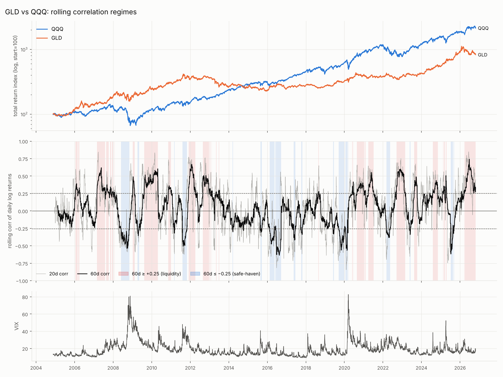
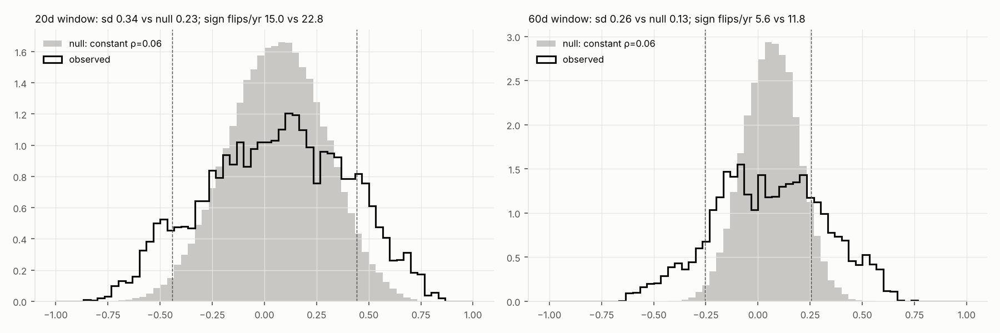
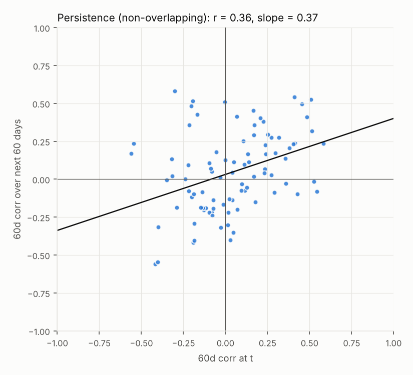
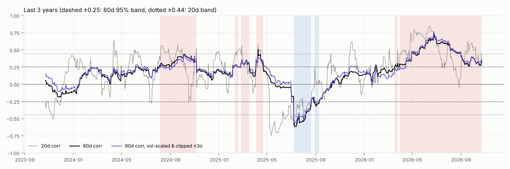
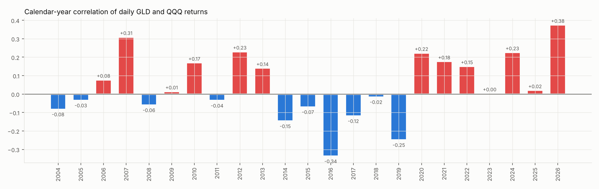

# 研究 01：黄金–QQQ 滚动相关性（20/60 日）与符号翻转

> 样本：GLD 与 QQQ 日度对数收益（已复权），2004-11-19 至 2026-10-23，共 5516 个交易日。
> 代码：`study_01_rolling_correlation.py`；数值全部来自 `artifacts/01_rolling_correlation/results.json`。

## TL;DR

1. **相关性的状态切换是真实的，不是噪声。** 60 日相关性的波动幅度（标准差 0.26）是"真实相关系数恒定"假设下的 2 倍（0.13）；有 35% 的时间落在 95% 显著带 ±0.25 之外，而纯噪声只有 5–8%。
2. **20 日相关性的符号翻转大多是噪声。** 噪声情况下 20 日相关性的标准差就有 0.23，显著带是 ±0.44。20 日相关性每年过零 15 次，噪声模型下也有 23 次。真正的"显著翻转"（从 +显著 到 −显著，或反过来）在 60 日口径下 22 年只有 16 次，约每年 0.7 次。
3. **"正相关＝流动性驱动"在机制上成立，但要说得更准确。** 正相关时，两个资产对美元的日度敏感度 90% 的时间同号（都为负）：此时美元/流动性这个共同因子主导了日度波动。但正相关**不等于两者一起涨**。当前这一段（2026-03 起）QQQ +26%，GLD −12%，日度相关性却稳定在 +0.3 到 +0.7。
4. **"负相关＝避险驱动"只对了一半。** 负相关时，QQQ 与实际利率同向（风险偏好上升时实际利率也上行），黄金与实际利率反向，市场在 risk-on/risk-off 之间轮动。但 2008 年 5–11 月和 2022 年 3–5 月这两段负相关期里，黄金与 QQQ 一起下跌（实际利率分别上升 163bp 和 107bp）。负相关不保证黄金上涨。
5. **对组合最有用的结论：前一天的 60 日相关性状态，能预判黄金在 QQQ 大跌日是否起对冲作用。**

   | QQQ 最差 5% 交易日（≤ −2.19%），按前一日的 60 日状态分组 | 天数 | GLD 当日平均收益 | t 值 | GLD 当日上涨的比例 |
   | --- | --- | --- | --- | --- |
   | 正相关（流动性）状态 | 56 | **−52bp** | −2.5 | **23%** |
   | 中性 | 165 | −4bp | −0.3 | 48% |
   | 负相关（避险）状态 | 55 | **+57bp** | +1.7 | **62%** |

   正相关状态下，黄金在 QQQ 大跌日大概率跟着下跌，这时只有现金能起对冲作用。
6. **当前（2026-10-23）处于正相关状态**：60 日相关性 0.32（稳健版 0.34），20 日 0.44（刚好在 20 日显著带下方）。这一段从 2026-03-31 开始，已持续 144 个交易日，是 2009–2010 年以来最长的一次正相关期；2026 年至今的日度相关性为 +0.38，是样本中最高的一年。

## 1. 方法

- **收益率**：先在价格层面按日期 inner join，再计算对数差分。黄金用 GLD 而不是 GC=F，原因是期货 13:30 ET 结算，与 QQQ 收盘时间不同步（见 `docs/data_pipeline_lessons.md` 第 11 条）。
- **滚动相关性**：20 日和 60 日窗口的 Pearson 相关系数。
- **显著带**：在真实相关系数为 0 的假设下，用 Fisher z 计算 95% 临界值 `tanh(1.96/√(n−3))`。20 日为 ±0.443，60 日为 ±0.254。
- **状态划分**：相关性 ≥ +临界值记为 *流动性（+）*，≤ −临界值记为 *避险（−）*，其余记为 *中性*。**显著翻转**指从 + 状态切换到 − 状态（或反过来），中间经过的中性期不计。
- **两个噪声基准**（各模拟 300 次）：
  - (A) 二元正态分布，相关系数恒定为全样本值 0.06；
  - (B) 把 GLD 的收益序列相对 QQQ 做随机循环平移：保留各自的厚尾和波动聚集，但两者的真实相关性约为 0。
- **稳健版本**：先用 EWMA 波动率（λ=0.94，只用到 t−1 的信息）标准化收益，再截断到 ±3σ，然后计算 60 日相关系数，用来检验结论是否受单个离群日左右。

## 2. 分布与噪声：哪些翻转是真的？

| | 20 日 | 60 日 |
| --- | --- | --- |
| 均值 / 中位数 | 0.056 / 0.071 | 0.055 / 0.051 |
| 相关性 > 0 的时间占比 | 57% | 57% |
| 观测到的标准差 vs 噪声模型 (A) | 0.34 vs 0.23 | 0.26 vs 0.13 |
| 落在显著带之外的时间占比：观测 vs 噪声 (A) / (B) | 22.8% vs 5.9% / 5.1% | 35.2% vs 7.7% / 4.9% |
| 每年过零次数：观测 vs 噪声 (A)，括号内为 90% 区间 | 15.0 vs 22.8 (20.5–25.2) | 5.6 vs 11.8 (9.7–14.3) |
| 显著翻转次数（22 年）：观测 vs 噪声 (A) / (B) | 36 vs 23.5 / 26.5 | 16 vs 6.5 / 9.6 |
| 处于流动性 / 避险状态的时间占比 | 14.0% / 8.8% | 23.6% / 11.6% |

怎么读这张表：

- 全样本的相关系数几乎为 0（日频 0.06，周频 0.07），所以**均值没有参考价值，有意义的是状态**。
- 观测到的过零次数**少于**噪声基准，说明相关性有持续性。但 60 日口径下仍然每年过零 5.6 次，其中大部分只是在 0 附近来回穿越。**不要把"过零"当成交易信号，要用显著带。**
- 60 日口径的显著翻转有 16 次，超过两个噪声基准的 90% 区间上限（12 和 14），说明确实存在可识别的状态。
- 20 日口径的显著翻转有 36 次，只是略高于噪声区间的上限（32/34）。**20 日窗口太短，适合做"预警"，不适合做"判定"。**
- 60 日的状态区段一共 87 段，但中位数只有 6 天，因为相关性经常在临界值附近来回穿越。持续至少 20 天的只有 24 段（流动性 14 段，避险 10 段）。实际使用时需要再加一层持续期过滤或滞后带（hysteresis）。

### 持续至少 20 天的状态区段（60 日口径，节选 12/24 段）

| 状态 | 起止 | 天数 | 区间 QQQ | 区间 GLD | VIX 均值 | 实际利率变化 |
| --- | --- | --- | --- | --- | --- | --- |
| + | 2007-02-28 → 2007-08-02 | 109 | +12.1% | +0.7% | 14.9 | +26bp |
| − | 2008-05-27 → 2008-11-03 | 113 | −31.8% | −22.1% | 31.9 | +163bp |
| + | 2009-08-12 → 2010-04-30 | 181 | +25.9% | +24.3% | 21.8 | −55bp |
| − | 2011-08-08 → 2011-10-31 | 60 | +7.8% | +3.5% | 35.4 | −12bp |
| + | 2011-11-30 → 2012-04-09 | 89 | +24.3% | −4.5% | 19.8 | −20bp |
| − | 2016-06-10 → 2016-09-19 | 70 | +6.5% | +3.4% | 14.6 | +8bp |
| − | 2019-09-16 → 2020-01-03 | 77 | +11.7% | +4.1% | 14.2 | −14bp |
| + | 2020-08-27 → 2021-01-07 | 92 | +8.1% | −2.1% | 26.0 | −2bp |
| − | 2022-03-09 → 2022-05-18 | 50 | −9.8% | −11.5% | 26.1 | +107bp |
| + | 2022-09-13 → 2023-02-27 | 115 | −5.0% | +5.2% | 23.9 | +58bp |
| − | 2025-07-08 → 2025-08-20 | 32 | +2.5% | +0.3% | 16.2 | −13bp |
| + | 2026-03-31 → 2026-10-23（进行中） | 144 | +26.4% | −11.6% | 17.2 | +64bp |

完整列表见 `artifacts/01_rolling_correlation/episodes60.csv`。

## 3. 标签对不对："流动性"和"避险"背后的机制

### 3.1 同一窗口内的宏观背景（按 60 日状态分组，取中位数）

| | 避险（−） | 中性 | 流动性（+） |
| --- | --- | --- | --- |
| 窗口数 | 640 | 3512 | 1304 |
| QQQ 60 日收益 | +2.7% | +4.4% | +5.2% |
| GLD 60 日收益 | +3.9% | +1.7% | +3.2% |
| VIX 均值 | 18.5 | 16.0 | 20.3 |
| 实际利率 60 日变化 | −7.5bp | +1.0bp | −3.0bp |
| 美元指数 60 日变化 | +0.2% | +0.5% | **−0.8%** |
| 两者都上涨的窗口占比 | 45% | 43% | 47% |
| 两者都下跌的窗口占比 | 14% | 9% | 9% |
| QQQ 跌、GLD 涨的窗口占比 | **28%** | 16% | 16% |

单看收益方向，三种状态的差别并不大：负相关状态下仍有 45% 的窗口两者一起涨。原因在于**相关系数衡量的是日度涨跌是否同步，而不是趋势方向是否一致**。比如 2016 年和 2019 年，黄金和 QQQ 都在上涨，但涨跌的日子正好错开（risk-on 那天买 QQQ，risk-off 那天买黄金）。

### 3.2 因子暴露：用来区分机制的关键证据（60 日滚动相关，按状态取均值）

| | 避险（−） | 中性 | 流动性（+） |
| --- | --- | --- | --- |
| QQQ 与 Δ实际利率 | **+0.27** | +0.10 | −0.01 |
| GLD 与 Δ实际利率 | −0.47 | −0.30 | −0.22 |
| QQQ 与 Δ美元 | +0.04 | −0.07 | **−0.32** |
| GLD 与 Δ美元 | −0.37 | −0.45 | −0.51 |
| 两者对实际利率的暴露同号的时间占比 | 5% | 41% | 66% |
| 两者对美元的暴露同号的时间占比 | 22% | 59% | **90%** |

- **流动性（+）状态 = 美元/流动性因子主导。** QQQ 和黄金同时对美元呈负暴露（90% 的时间同号）。美元走弱、流动性宽松时两者同涨，流动性收紧时同跌。2022 年 9 月至 2023 年 2 月那一段（实际利率 +58bp）是典型的"利率/美元共振"。
- **避险（−）状态 = 风险偏好因子主导。** QQQ 与实际利率**同向**（增长预期推高实际利率，股票也涨），黄金与实际利率反向，两者对利率的暴露几乎从不同号（5%）。所以"负相关＝避险"更准确的说法是：**市场在增长/风险偏好之间切换，黄金站在 QQQ 的对立面**。
- 但这个对立面也可能是**两者一起跌**：2008 年下半年和 2022 年上半年，实际利率急升（+163bp / +107bp），日度上两者此消彼长，趋势上却双双下跌。负相关只说明黄金在 QQQ 的坏日子里相对抗跌，不保证黄金的绝对收益为正。

## 4. 能否提前判断？（只用 t 日及以前的信息）

### 4.1 持续性

- 当前 60 日相关性与**下一个** 60 日窗口的相关性：r = 0.36（90 个不重叠样本），斜率 0.37。20 日口径：r = 0.41（274 个样本）。
- 60 日状态的转移概率（不重叠窗口，行为当前状态，列为下一窗口的状态）：

  | 当前 → 下一窗口 | 避险 | 中性 | 流动性 |
  | --- | --- | --- | --- |
  | 避险 | 33% | 56% | 11% |
  | 中性 | 10% | 71% | 19% |
  | 流动性 | **0%** | 63% | 37% |

  状态大约只有三分之一的概率延续到下一个季度，更常见的是回到中性。**从流动性状态直接跳到避险状态，样本中一次都没有发生过。**

### 4.2 尾部对冲（核心结论，见 TL;DR 第 5 条）

QQQ 大跌日黄金的表现，取决于前一天所处的状态：流动性状态下平均 −52bp（t=−2.5，上涨比例 23%），避险状态下平均 +57bp（t=+1.7，上涨比例 62%）。全样本不分状态时平均为 −1bp，**这说明"黄金能对冲 QQQ"这个说法，只在特定状态下成立**。

需要注意：大跌日往往扎堆出现在同一场危机里（2008、2020、2022），实际的独立样本数远少于 56 或 55，t 值偏乐观。

### 4.3 未来 60 日的分散效果（50/50 组合，每日再平衡）

分散比率 = 组合波动率 ÷ 两个资产波动率的平均值，越低说明分散效果越好。按当前状态分组：流动性 0.78（n=19），中性 0.72（n=61），避险 0.70（n=10）。方向与预期一致，但样本太少，差异不显著。"QQQ 下跌时黄金在未来 60 日的表现"这一项，每组只有 3–15 个样本，不下结论。

## 5. 稳健性

| 检查 | 结果 |
| --- | --- |
| 用 IAU 代替 GLD | 60 日相关性的平均绝对差 0.0085（最大 0.07） |
| 用 GC=F 代替 GLD | 60 日相关性平均低 0.031；滞后一天的相关性（0.048）高于同期（0.034），这是收盘不同步造成的，结论不受影响但应弃用 GC=F |
| 周频 13 周相关性 vs 日频 60 日相关性 | 两者的相关性 0.71，符号一致的时间占 76% |
| 稳健版本（EWMA 标准化 + 截断 ±3σ） | 与原版相关性 0.98，状态一致的时间占 94%，**从未给出相反的状态**；显著翻转 18 次（原版 16 次） |
| 离群日效应 | 60 日相关性最大的单日跳变（−0.42，2025-07-08）来自 2025-04-09 那一天移出窗口，而不是新的市场信息 |

## 6. 对"现金 / 黄金 / QQQ + 定投"的启示

1. **黄金不是无条件的 QQQ 对冲。** 流动性（+）状态下，QQQ 大跌时黄金大概率同跌，这时能起对冲作用的只有现金。当前正处于这个状态。
2. **用 60 日状态，不用 20 日的过零。** 20 日相关性只适合做预警（比如 20 日已经跌破 −0.44，而 60 日还没跟上）。判定状态时需要显著带，外加持续期过滤（区段中位数只有 6 天，直接使用会频繁切换）。
3. **定投天然适合做"状态感知"。** 只调整新增资金流向哪个资产，不卖出已有持仓，因此没有交易成本，也不触发税务事件。一个可检验的规则草案：流动性状态下，原本分给黄金的那部分新增资金改投现金；避险状态下恢复投入黄金。这是研究 02 要回测的内容。
4. **状态的持续性只有一个季度左右**（r≈0.36，延续概率约 1/3），所以只适合用于"边际调整"，不适合据此做大幅度的仓位切换。

## 7. 局限与下一步

- 样本受 GLD 上市时间（2004-11）限制，22 年里持续至少 20 天的状态区段只有 24 段，统计功效有限。2004 年以前的数据可以考虑用 GC=F 周频补齐。
- Pearson 相关性对离群日敏感，滚动窗口还会让同一个状态在样本里被重复计数。下一步可以试 EWMA 或 DCC-GARCH 估计的时变相关性。
- 因子分析只做了相关性。下一步可以把两个资产的收益同时对 Δ实际利率、Δ美元、ΔVIX 做回归，直接拆出"共同因子贡献的相关性"。
- 所有结论都是样本内的描述性统计。研究 02 会用滚动的样本外方式检验定投规则。
