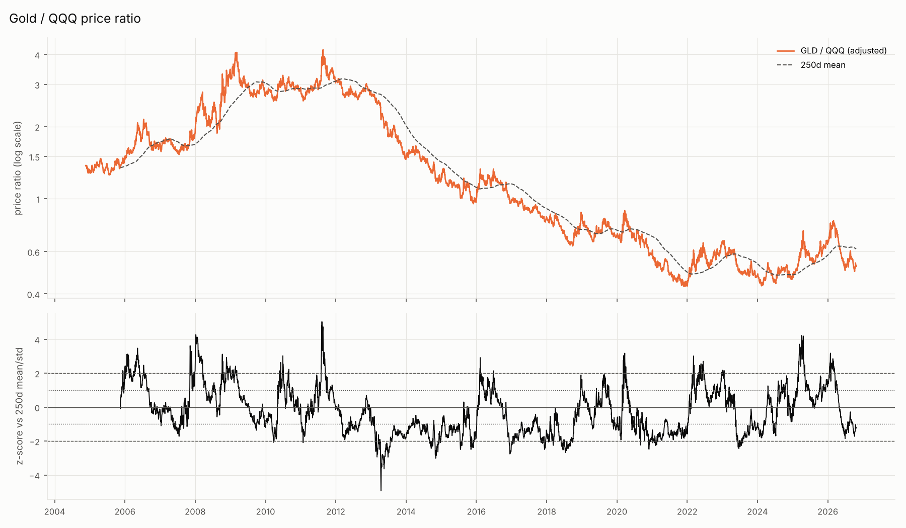
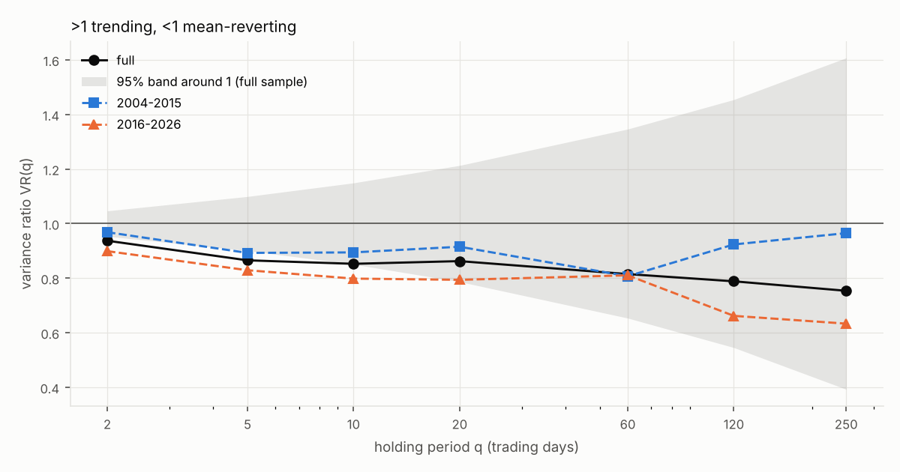
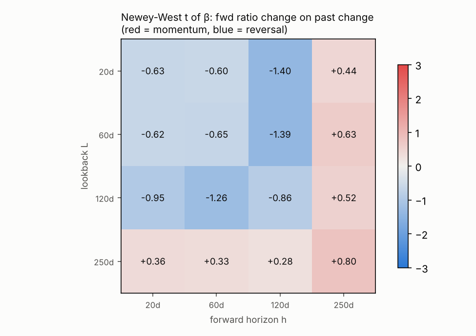
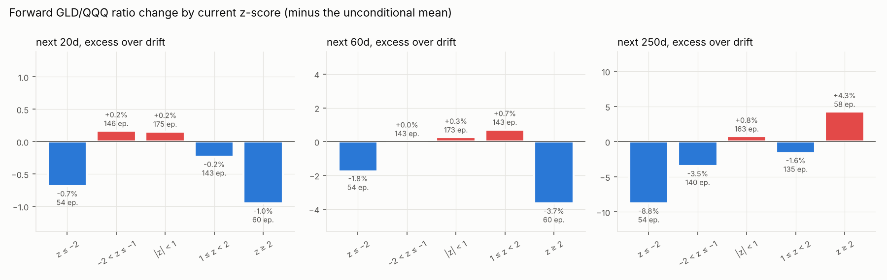
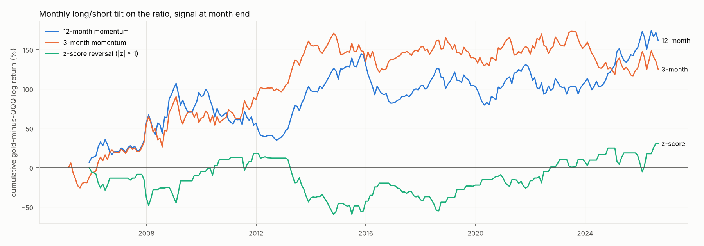

# 研究 02：金/QQQ 比值的动量与均值回复

> 样本：GLD 与 QQQ 日度复权价，2004-11-19 至 2026-10-23，共 5516 个交易日。研究对象是比值的对数 `x = ln(GLD/QQQ)`，它的日度变化就是两者的收益差 `r_GLD − r_QQQ`。
> 代码：`study_02_ratio_momentum_reversion.py`；数值全部来自 `artifacts/02_ratio_momentum_reversion/results.json`。

## TL;DR

1. **比值不会"回到均值"。** 全样本 ADF 统计量 −0.48，前后两段分别为 −0.77 和 −1.98，都远没到 5% 临界值 −2.86。AR(1) 系数 0.99978，对应的半衰期约 3083 个交易日（**12 年**）。22 年里比值的对数下跌了 97%（只剩起点的 38%），中途没有出现过任何"回归"。把比值当成一个会回到某条均线的价差来交易，没有统计依据。
2. **唯一显著的"均值回复"在日频，而且来自 QQQ 自身。** 方差比在 2 日和 5 日显著小于 1（VR 0.94 / 0.87，z ≈ −2.6）。拆开看，比值滞后一阶自协方差的 **79%** 来自 QQQ 自己的日度反转，GLD 只贡献 11%。这种反转只在 2016 年以后显著（QQQ 一阶自相关 −0.12），对月度定投没有用处。
3. **1–12 个月的动量和反转都不显著。** 16 组"过去 L 日 → 未来 h 日"的预测回归里，Newey-West t 值的绝对值都不超过 1.41，R² 都不超过 1.2%。用不重叠样本复核，最大的 |t| 是 1.74。
4. **月度择时规则：前后两段的结论相反。** 12 个月动量在 2004–2015 年年化 +12.9%，2016–2026 年降到 +1.7%。|z| ≥ 1 的反转规则正好相反：前段 −4.2%，后段 +8.0%。全样本最好的是 12 个月动量（循环平移 p = 0.052，t = 1.39），但这是 5 个信号里挑出来的最好一个，做多重检验修正后不显著。
5. **当前（2026-10-23）的读数互相矛盾。** 比值的 250 日 z 值为 −1.23，过去 1/3/6/12 个月分别 −1.5%、−5.9%、−17.1%、−16.6%。所有动量信号都说"偏向 QQQ"，反转信号说"偏向黄金"。
6. **对组合的结论：黄金/QQQ 之间的新增资金分配保持固定比例，不用比值做择时。** 比值没有可收割的均值回复，所以再平衡的作用只是控制风险，而不是"低买高卖"赚收益。比值的波动在避险状态下最大（年化 40%，流动性状态下为 23%），也就是说，权重偏离最快的恰好是避险状态。研究 04 的定投路由规则会用到这一点。

## 1. 方法

- **比值**：`x_t = ln(GLD_t / QQQ_t)`，两者都用复权价，先在价格层面 inner join，再取对数。比值上涨表示黄金跑赢。
- **平稳性**：
  - ADF 检验：带常数项，滞后阶数用 AIC 在 0–12 之间选，临界值取 MacKinnon（1% / 5% / 10% = −3.43 / −2.86 / −2.57）。
  - AR(1) 半衰期：`ln(0.5) / ln(φ)`。
- **方差比（Lo-MacKinlay）**：`VR(q) = Var(q 日收益) / (q × Var(1 日收益))`，使用重叠的 q 日收益，z 值用异方差稳健的 z*。VR > 1 表示趋势，VR < 1 表示均值回复。q 取 2、5、10、20、60、120、250 日。
- **预测回归**：用过去 L 日的比值变化预测未来 h 日的比值变化，L 和 h 都取 20、60、120、250（约 1、3、6、12 个月）。
  - 日度重叠样本的残差是 MA(h−1)，所以用 Newey-West（滞后 h 期）标准误。
  - 即使这样，h 较长时仍会过度拒绝，所以每 h 天取一个不重叠样本再做一次普通 OLS 复核。
- **z 值分桶**：`z = (x − 250 日均值) / 250 日标准差`，按 z 分 5 档，统计未来 20/60/250 日的比值变化。
  - 全样本比值下跌了 97%，任何条件均值都会被这个漂移主导，所以同时报告**相对漂移的超额**（条件均值减去无条件均值）。
  - 重叠窗口会让"天数"高估证据量，所以另外报告"进入该档的次数"（episodes）。
- **月度信号**：在月末计算信号，用下个月的比值变化计算收益（正号表示偏向黄金）。正在进行中的月份不计入。
  - `momk`：过去 k 个月比值变化的符号，k = 1、3、6、12。
  - `rev_z`：z ≥ 1 时偏向 QQQ，z ≤ −1 时偏向黄金，其余时间空仓。
  - **收益拆分**：拆成"漂移"（平均仓位 × 平均收益）和"择时"（其余部分）。一个总是偏向 QQQ 的信号，不需要任何择时能力也能赚到比值下跌的漂移。
  - **循环平移检验**（2000 次，最小平移 12 个月）：把信号序列相对收益序列循环平移，保留信号的持仓结构和自相关，只打乱两者的对齐。因此它检验的只是择时能力。
- **样本切分**：2004–2015 和 2016–2026 两段。

## 2. 比值是随机游走，还是会回复？

### 2.1 单位根

| | ADF 统计量 | 滞后阶数 | 5% 拒绝？ |
| --- | --- | --- | --- |
| 全样本 | −0.48 | 2 | 否 |
| 2004–2015 | −0.77 | 8 | 否 |
| 2016–2026 | −1.98 | 9 | 否 |

AR(1) 系数 φ = 0.99978，半衰期 3083 个交易日（约 12.2 年），比整个样本的一半还长。即使比值真的是平稳的，这个回复速度对定投决策也没有意义。

### 2.2 方差比

| q（日） | 全样本 VR | z* | 2004–2015 VR | z* | 2016–2026 VR | z* |
| --- | --- | --- | --- | --- | --- | --- |
| 2 | 0.94 | **−2.64** | 0.97 | −0.94 | 0.90 | **−3.02** |
| 5 | 0.87 | **−2.66** | 0.89 | −1.48 | 0.83 | **−2.46** |
| 10 | 0.85 | −1.94 | 0.89 | −0.96 | 0.80 | −1.96 |
| 20 | 0.86 | −1.26 | 0.92 | −0.53 | 0.79 | −1.43 |
| 60 | 0.82 | −1.05 | 0.81 | −0.73 | 0.81 | −0.85 |
| 120 | 0.79 | −0.91 | 0.92 | −0.22 | 0.66 | −1.17 |
| 250 | 0.75 | −0.79 | 0.97 | −0.07 | 0.63 | −0.96 |

怎么读：

- 所有点估计都小于 1，看起来像均值回复，但只有 2 日和 5 日显著，而且只在 2016 年以后显著。
- 长期限的 VR 检验功效很低：22 年只有大约 22 个不重叠的年度观测，所以"不显著"的意思是**证据不足**，而不是"证明没有均值回复"。要据此做决策，应该按"没有可用的均值回复"来处理。

### 2.3 短期反转从哪来？

比值的日度收益是 `d = g − q`。它的一阶自协方差可以拆成四项：

`acov(d) = acov(g) + acov(q) − cov(g_t, q_{t+1}) − cov(q_t, g_{t+1})`

| 来源 | 占比 |
| --- | --- |
| QQQ 自身的一阶自协方差 | **79%** |
| GLD 自身的一阶自协方差 | 11% |
| −cov(GLD_t, QQQ_{t+1}) | −23% |
| −cov(QQQ_t, GLD_{t+1}) | +33% |

| | 比值一阶自相关 | QQQ 一阶自相关 | GLD 一阶自相关 |
| --- | --- | --- | --- |
| 2004–2015 | −0.032 | −0.042 | −0.022 |
| 2016–2026 | **−0.100** | **−0.116** | −0.006 |

结论：比值的日度反转，本质上是 2016 年以后 QQQ 自己的日度反转（大涨之后第二天倾向于回吐）。黄金几乎没有贡献。这是一个日频现象，定投的决策频率是月度，用不上。

## 3. 能否用过去的比值走势预测未来？

### 3.1 预测回归（16 组 L × h）

| L \ h | 20 | 60 | 120 | 250 |
| --- | --- | --- | --- | --- |
| 20 | −0.63 | −0.60 | −1.40 | +0.44 |
| 60 | −0.62 | −0.65 | −1.39 | +0.63 |
| 120 | −0.95 | −1.26 | −0.86 | +0.52 |
| 250 | +0.36 | +0.33 | +0.28 | +0.80 |

（表中是斜率的 Newey-West t 值；负值表示反转，正值表示动量。）

- 没有任何一格显著。R² 都不超过 1.2%。不重叠样本的 t 值也都在 ±1.74 以内（最大的是 L = h = 120，t = −1.74，只有 44 个样本）。
- 方向上有一个模式：回看和预测都在 1–6 个月以内时，系数都是负的（弱反转）；只要有一边是 12 个月（回看 250 日，或预测 250 日），系数就是正的（弱动量）。形状和"短期反转、12 个月动量"的经典结论一致，但幅度太小，无法与噪声区分。
- 最大的经济差异在 L = h = 250：过去一年比值上涨后，未来一年平均 −1.4%；下跌后平均 −7.7%，相差 6.3 个百分点。但 t 值只有 0.80（不重叠样本 1.30，n = 21）。

### 3.2 极端 z 值之后（相对漂移的超额收益）

| z 档位（进入次数） | 未来 20 日 | 未来 60 日 | 未来 250 日 |
| --- | --- | --- | --- |
| z ≤ −2（54 次） | −0.7% | −1.8% | **−8.8%** |
| −2 < z ≤ −1 | +0.2% | +0.0% | −3.5% |
| \|z\| < 1 | +0.2% | +0.3% | +0.8% |
| 1 ≤ z < 2 | −0.2% | +0.7% | −1.6% |
| z ≥ 2（60 次） | −1.0% | **−3.7%** | **+4.3%** |

如果比值有均值回复，表格应该是"左上负、右下正"的对称形状：z 越低，未来越往上走。实际情况是：

- **z ≤ −2（黄金相对极度便宜）之后，黄金继续跑输**，250 日超额 −8.8%。这是延续，不是回复。
- **z ≥ 2（黄金相对极度昂贵）之后**，60 日有回落（−3.7%），250 日却继续上涨（+4.3%）。
- 两个极端档位各自只有 54–60 次进入，而且窗口高度重叠。这种不对称、不一致的形状更像噪声，不足以构成规则。

## 4. 月度择时规则

下表的收益指"做多黄金、做空 QQQ"（或者反过来）的 1:1 多空组合，年化。年化波动约 24%，所以年化 +5% 对应的夏普比率只有 0.2。

| 信号 | 全样本年化 | 其中：漂移 / 择时 | t（NW） | 循环平移 p | 2004–2015 | 2016–2026 |
| --- | --- | --- | --- | --- | --- | --- |
| 1 个月动量 | +2.4% | +0.4% / +2.0% | 0.45 | 0.34 | +2.1% | +3.7% |
| 3 个月动量 | +5.8% | +0.6% / +5.2% | 1.13 | 0.15 | **+12.4%** | −2.1% |
| 6 个月动量 | +2.3% | +0.8% / +1.5% | 0.45 | 0.32 | +5.0% | −1.6% |
| 12 个月动量 | **+7.7%** | +0.6% / +7.1% | 1.39 | **0.052** | **+12.9%** | +1.7% |
| z 反转（\|z\| ≥ 1，58% 的月份有仓位） | +1.5% | −0.8% / +2.2% | 0.35 | 0.38 | −4.2% | **+8.0%** |

- **漂移的贡献很小**（每年不到 1%），收益主要来自择时部分，所以这些数字不是"顺着比值下跌方向"白捡来的。
- **最好的 12 个月动量也不显著**：t = 1.39，循环平移 p = 0.052，而且这是 5 个信号里最好的一个。做多重检验修正后（比如 Bonferroni 要求 p < 0.01），不显著。
- **前后两段完全反转**：动量在 2004–2015 年有效（黄金 2001–2011 年的大牛市、2013 年的崩盘，都是长趋势），2016 年以后失效。反转规则正好相反，前段亏钱，后段年化 +8.0%（t = 1.60）。哪一段更能代表未来，样本里没有信息可以判断。
- **对定投的实际影响很小。** 上表是满仓多空的收益，而定投择时只影响**新增资金**的去向。假设每月新增资金占组合的 1–2%，即使信号真实有效，对整个组合年化收益的贡献也是"基点"量级。

## 5. 与研究 01 的联系：比值波动随相关性状态变化

比值的日度方差 `Var(g − q) = Var(g) + Var(q) − 2·Cov(g, q)`，所以相关性越负，比值波动越大。按研究 01 的 60 日状态分组：

| 60 日状态 | 天数 | 比值年化波动 |
| --- | --- | --- |
| 流动性（+） | 1304 | 23.3% |
| 中性 | 3513 | 26.2% |
| 避险（−） | 640 | **39.9%** |

避险状态下，黄金和 QQQ 的相对权重偏离得最快（波动大约是流动性状态的 1.7 倍）。这不是择时信号，而是一个**再平衡需求**的信号：同样的权重偏离容忍度下，避险状态会更频繁地触发再平衡。用定投资金流向来再平衡（不卖出），在这种时候最有价值。

## 6. 当前读数（2026-10-23）

| 指标 | 数值 | 信号含义 |
| --- | --- | --- |
| 比值 GLD/QQQ | 0.520 | — |
| 250 日 z 值 | −1.23 | z 反转规则：**偏向黄金** |
| 过去 20 / 60 / 120 / 250 日 | −1.5% / −5.9% / −17.1% / −16.6% | 所有动量规则：**偏向 QQQ** |

已完成评分的最后一个月是 2026-08（用 9 月的比值变化评分）。两类信号方向相反，各自又都不显著，所以当前没有可执行的倾斜方向。

## 7. 对"现金 / 黄金 / QQQ + 定投"的启示

1. **黄金与 QQQ 之间按固定比例分配新增资金**，不根据比值的动量或 z 值做择时。证据要么不显著，要么在前后两段方向相反。
2. **再平衡是为了控制风险，不是为了赚收益。** 比值没有可收割的均值回复（单位根，半衰期约 12 年），"再平衡溢价"不应该计入预期收益。
3. **用阈值触发再平衡，并优先通过定投资金流向来完成。** 避险状态下比值的波动是平时的 1.5–1.7 倍，权重偏离得更快。研究 04 会把它与研究 01 的状态规则合在一起回测。
4. 现金腿与这个结论无关：现金和黄金/QQQ 之间怎么分配，由研究 01 的相关性状态和风险预算决定。

## 8. 局限

- **多重检验**：本研究看了 16 组预测回归、21 个方差比、5 个月度信号 × 3 个时间段。在这么多次检验里，出现一两个 |t| ≈ 2 的结果是预期之内的。只有日频 VR（被拆解成 QQQ 自身的反转）同时通过了多个口径的检验。
- **长期限检验功效低**：样本 22 年，12 个月期限的独立观测只有约 21 个。小于 1 的长期 VR 点估计（0.63–0.75）没法排除真实存在的慢速均值回复，但即使存在，半衰期也以年计，对定投决策没有用。
- **样本切分点（2015 年底）是事先固定的整年分界**，没有为了让结论更好看而搜索切分点。即使这样，"前后两段相反"本身也只是两个样本点，不能据此推断"现在该用反转"。
- 只研究了比值本身。动量或反转是否可以用宏观状态（实际利率、美元）来条件化，留给后续的因子模型研究。
