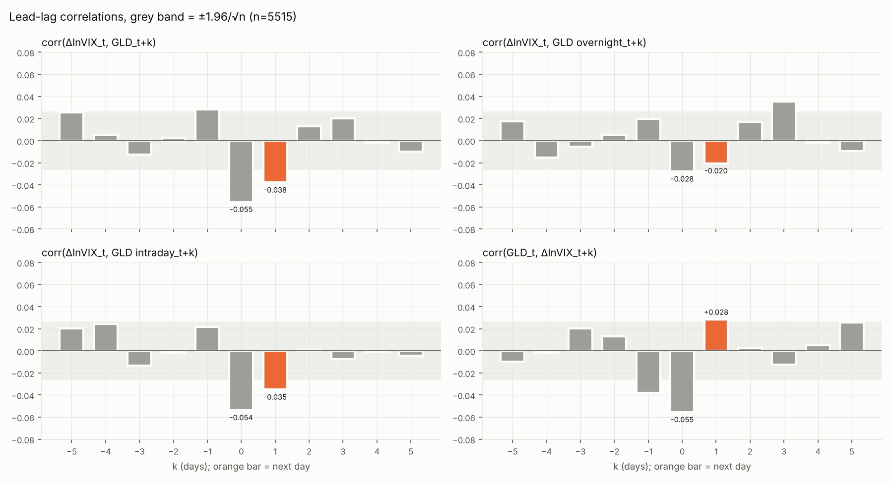
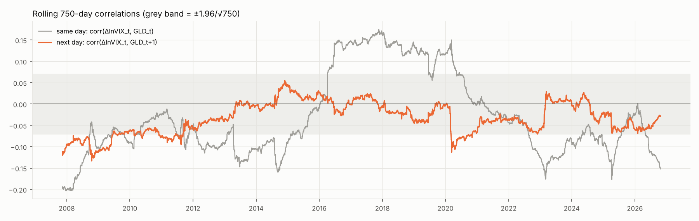
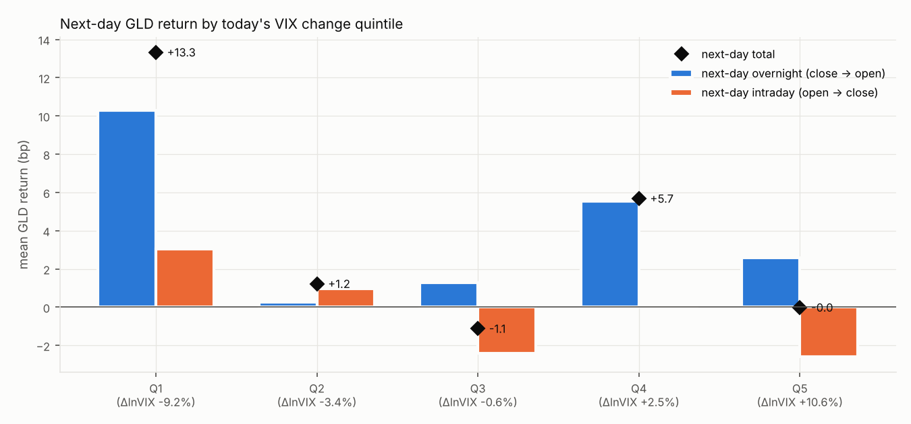
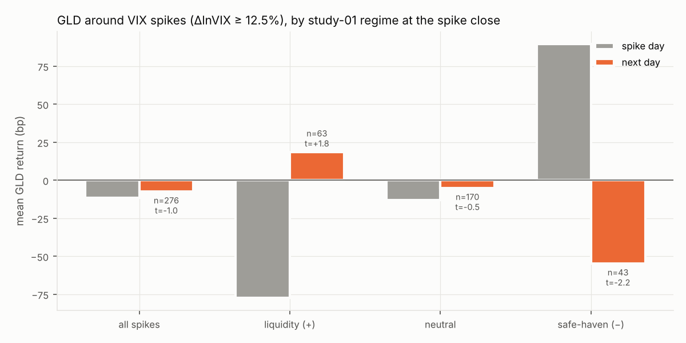

# 研究 03：谁领先谁？VIX 变化与黄金次日收益的滞后相关

> 样本：GLD（开盘价/收盘价）、QQQ（复权收盘价）、^VIX（日收盘），2004-11-19 至 2026-10-23，共 5516 个交易日。另外用 ^VIX 1 小时 K 线构造 16:00 ET 的 VIX（2024-01 起，685 天），做收盘时间校验。
> 代码：`study_03_vix_gold_lead_lag.py`；数值全部来自 `artifacts/03_vix_gold_lead_lag/results.json`。
> 记号：`v_t = Δln VIX_t`，`g` 为 GLD 日收益，`q` 为 QQQ 日收益。GLD 次日收益拆成**隔夜**（前收盘 → 开盘）和**日内**（开盘 → 收盘）两段。

## TL;DR

1. **VIX 不能可靠地领先黄金，黄金也不能领先 VIX。**
   - 今天 VIX 的变化与明天 GLD 收益的相关系数是 −0.038，刚好落在 iid 显著带 ±0.026 之外，R² 只有 0.14%。
   - 回归里加入当天的 GLD 和 QQQ 收益作为控制变量后，VIX 的 t 值从 −2.46 降到 −0.90。也就是说，这点相关性被当天的股票和黄金行情吸收了，VIX 没有额外信息。
   - Granger 检验（各 5 阶滞后，Newey-West 稳健 Wald）：VIX → GLD 的 p = 0.38，GLD → VIX 的 p = 0.29。
2. **线性关系的符号不稳定。** 三个子样本里，corr(v_t, g_{t+1}) 分别是 −0.073（2004–2012）、+0.010（2013–2019）、−0.038（2020–2026），没有一段显著。750 日滚动相关只在 2012 年以前和 2020 年初跑出过显著带。
3. **不是收盘时间造成的假象。** VIX 日收盘是 16:15 ET，比 GLD 晚 15 分钟。用小时 K 线重建 16:00 的 VIX 后，次日相关系数从 −0.019 变为 −0.024，基本不变。这 15 分钟只占 ΔlnVIX 方差的 2%。
4. **唯一稳健的非线性模式：VIX 大跌之后，黄金次日上涨。**
   - VIX 跌幅最大的 20% 交易日（平均 −9.2%），GLD 次日平均 **+13.3bp**（t = 3.70），其中 10.3bp 发生在**隔夜**（t = 3.83），日内只有 3.0bp（t = 1.40）。
   - 这些日子里有 57% 同时是 QQQ 涨幅最大的 20% 交易日。但控制"QQQ 大涨日"后效应仍有 14.2bp（t = 3.18）。
   - **效应集中在 2004–2012 年**（+27.5bp，t = 4.39），2013–2019 年几乎消失（+2.7bp），2020 年以后 +12.5bp（t = 1.78）。
   - 大部分收益在隔夜，收盘后才看到信号的投资者，到第二天开盘才能买入，已经错过了。
5. **VIX 飙升日之后，黄金当天的走势会部分回吐，回吐方向由研究 01 的相关性状态决定。**

   | VIX 飙升日（ΔlnVIX ≥ 12.5%，前 5%），按当天的 60 日状态分组 | 天数 | GLD 当天 | GLD 次日 | t | 次日上涨比例 | 之后 5 日 |
   | --- | --- | --- | --- | --- | --- | --- |
   | 全部 | 276 | −12bp | −8bp | −1.0 | 50% | +12bp |
   | 流动性（+） | 63 | **−77bp** | **+19bp** | +1.8 | 65% | +70bp |
   | 中性 | 170 | −13bp | −5bp | −0.5 | 45% | +15bp |
   | 避险（−） | 43 | **+89bp** | **−55bp** | **−2.2** | 44% | −81bp |

   方向和直觉一致：流动性状态下黄金跟着股票被抛售，之后反弹；避险状态下黄金被追涨，之后回落。但对全部飙升日做"次日收益对当天收益"的回归，斜率只有 −0.063（t = −1.14）。避险组的 43 天又集中在少数几次危机里，这个结论只能算**提示性的**。
6. **对组合的结论：VIX 不能用作黄金的择时信号。** 唯一可以考虑的是一条执行层面的小规则：避险状态下 VIX 飙升、黄金当天大涨之后，把原定的黄金定投推迟几天。证据偏弱，但推迟几天几乎没有成本。

## 1. 方法

- **收盘时间是这个研究里最大的坑。**
  - GLD 和 QQQ 在 16:00 ET 收盘，但 Yahoo 的 ^VIX 日收盘是 **16:15 ET**（实测 2026-10-23：日线收盘 19.79，16:00 时为 19.45）。因此 `v_t` 里包含 15 分钟 GLD 当天没法反映的信息，这部分只能在 t+1 日体现出来，即使 VIX 对黄金毫无预测力，也会制造出机械性的"次日相关"。
  - 处理方式一：把 GLD 次日收益拆成**隔夜**和**日内**两段。在 16:15 看到 VIX 后，最早只能在次日开盘买入，所以只有**日内**这一段是可交易的。
  - 处理方式二：用 ^VIX 1 小时 K 线（标记为 15:00 的那根，收盘于 16:00）重建 16:00 的 VIX，把 `v_t` 拆成"16:00 到 16:00 的变化"和"16:00 到 16:15 的收盘后部分"。Yahoo 只提供最近约 730 天的小时数据，所以这个校验只覆盖 2024-01 以后。
  - GLD 不分红，开盘价、收盘价和复权价在同一个价格基准上，隔夜/日内拆分才成立（脚本里有断言检查）。QQQ 分红，不能这样拆，见 `docs/data_pipeline_lessons.md` 第 22 条。
- **交叉相关**：`corr(v_t, y_{t+k})`，k = −5 … +5。k > 0 表示 VIX 领先。iid 显著带为 `±1.96/√n = ±0.026`。
- **预测回归**：`g_{t+1}` 对 `v_t` 回归，再加入 `g_t`、`q_t` 作为控制变量；Newey-West 标准误，滞后 5 期。
- **Granger 检验**：被解释变量对 v、g、q 各自的 0–4 阶滞后做回归，对其中一个变量的 5 个系数做联合 Wald 检验（稳健协方差，精确 χ² 尾概率）。
- **非线性检验**：
  - 按 `v_t` 分五等分，看次日 GLD 收益（总的、隔夜、日内）。
  - VIX 飙升日（`v_t` ≥ 95% 分位，即 +12.5%），按研究 01 的 60 日相关性状态分组。状态用当天收盘时已知的数据计算，不含未来信息。
- **稳健性**：三个子样本（2004–2012、2013–2019、2020–2026），750 日滚动相关，以及"VIX 大跌日是否只是 QQQ 大涨日"的控制回归。

## 2. 线性领先-滞后关系

### 2.1 交叉相关

| k | −2 | −1 | 0 | +1 | +2 | +3 |
| --- | --- | --- | --- | --- | --- | --- |
| corr(v_t, GLD_{t+k}) | +0.003 | +0.028 | −0.055 | **−0.038** | +0.013 | +0.020 |
| 其中：隔夜 | +0.005 | +0.020 | −0.028 | −0.020 | +0.017 | +0.035 |
| 其中：日内 | −0.002 | +0.021 | −0.054 | −0.035 | +0.001 | −0.008 |
| corr(v_t, QQQ_{t+k}) | +0.042 | +0.082 | −0.714 | +0.045 | −0.004 | −0.011 |

（显著带 ±0.026。k = −1 那一列就是"GLD 领先 VIX"：corr(GLD_t, v_{t+1}) = +0.028。）

- 当天的相关性 −0.055 并不高：平均来说 VIX 上涨的日子黄金略跌，但远不像 VIX 和 QQQ 那样强绑定（−0.71）。
- k = +1 和 k = −1 都刚好擦着显著带的边。如果把 11 个滞后都看一遍，有一两个出界是正常的。

### 2.2 回归和 Granger 检验

| 回归（被解释变量 ← 解释变量） | v 的系数 | t（NW） | R² |
| --- | --- | --- | --- |
| g_{t+1} ← v_t | −0.0058 | −2.46 | 0.14% |
| g_{t+1} ← v_t, g_t, q_t | −0.0031 | −0.90 | 0.21% |
| GLD 次日隔夜 ← v_t, g_t, q_t | −0.0026 | −1.06 | 0.06% |
| GLD 次日日内 ← v_t, g_t, q_t | −0.0005 | −0.22 | 0.23% |
| v_{t+1} ← g_t, v_t, q_t（g 的系数） | +0.148 | +1.53 | 0.95% |

| Granger（5 阶，稳健 Wald） | χ² | p |
| --- | --- | --- |
| VIX → GLD | 5.28 | 0.38 |
| VIX → GLD 隔夜 | 5.81 | 0.33 |
| VIX → GLD 日内 | 2.98 | 0.70 |
| GLD → VIX | 6.22 | 0.29 |

结论：两个方向都没有领先关系。单变量回归里 t = −2.46，看起来显著，但这只是因为 `v_t` 和当天 QQQ、GLD 的收益相关；一旦把当天行情放进回归，VIX 本身没有增量信息。

顺带一提：VIX 今天上涨、QQQ 明天也上涨（corr +0.045），同样是被 QQQ 自身的日度反转解释掉的（加入 q_t 后 VIX 的 t = −1.10，q_t 的 t = −2.74）。这与研究 02 发现的"2016 年后 QQQ 日度反转"是同一个现象。

### 2.3 稳定性

| 子样本 | 天数 | corr(v_t, g_{t+1}) | corr(v_t, g_t)（当天） | v 的 t（控制 g、q） |
| --- | --- | --- | --- | --- |
| 2004–2012 | 2042 | −0.073 | −0.091 | −1.39 |
| 2013–2019 | 1762 | +0.010 | +0.072 | +0.94 |
| 2020–2026 | 1711 | −0.038 | −0.121 | −1.14 |

- 次日相关（橙线）在 2012 年以前稳定为负（约 −0.07 到 −0.12），之后大部分时间在显著带内，只有 2020 年初到 2021 年短暂跌出过。
- **当天相关（灰线）的变化更大**：2008 年前后约 −0.20，2016–2019 年转为 +0.10 到 +0.17（VIX 上涨时黄金也上涨，黄金在发挥避险作用），2023 年以后又多次跌到 −0.15 左右。这和研究 01 中"黄金–QQQ 相关性存在状态切换"是同一件事的另一面：VIX 与 QQQ 高度负相关（−0.71），所以黄金与 VIX 的同期相关，基本上就是黄金与 QQQ 相关的镜像。

### 2.4 收盘时间校验（2024-01-10 至 2026-10-22，685 天）

| | 数值 |
| --- | --- |
| 收盘后 15 分钟（16:00→16:15）占 ΔlnVIX 方差的比例 | 2.0% |
| 收盘后 15 分钟变化的标准差 | 1.17% |
| 与当天 GLD / QQQ 收益的相关 | +0.014 / +0.013 |
| corr(v_t, g_{t+1})：16:15 口径 vs 16:00 口径 | −0.019 vs −0.024 |
| corr(收盘后 15 分钟, g_{t+1})：总的 / 隔夜 / 日内 | +0.045 / +0.050 / +0.011 |
| 回归 g_{t+1} ← v1600, post：两者的 t | −0.67 / +1.21 |

- 换成 16:00 的 VIX 后，次日相关性几乎不变（甚至略强），所以全样本的 −0.038 不是收盘时间不同步造成的。
- 收盘后 15 分钟与当天 GLD 不相关（+0.014），说明这段时间确实是 GLD 当天收盘价没有反映的信息。它与次日 GLD 的相关是 +0.045（主要在隔夜），方向与机械效应一致，但不显著（t = 1.21），而且这只是 2.8 年的样本。
- 这一节的样本本身很短，次日相关在这段时间里也不显著（t = −0.51），只能用来排除"时间错位制造了相关性"这种解释，不能用来估计效应大小。

## 3. 非线性：VIX 大幅变化之后

### 3.1 按 VIX 变化五等分

| VIX 变化五等分 | 平均 ΔlnVIX | GLD 次日 | t | 隔夜 | t | 日内 | t |
| --- | --- | --- | --- | --- | --- | --- | --- |
| Q1（大跌） | −9.2% | **+13.3bp** | **3.70** | **+10.3bp** | **3.83** | +3.0bp | 1.40 |
| Q2 | −3.4% | +1.2bp | 0.38 | +0.3bp | 0.11 | +1.0bp | 0.41 |
| Q3 | −0.6% | −1.1bp | −0.33 | +1.3bp | 0.52 | −2.4bp | −1.08 |
| Q4 | +2.5% | +5.7bp | 1.67 | +5.5bp | 2.33 | +0.1bp | 0.06 |
| Q5（大涨） | +10.6% | −0.0bp | −0.01 | +2.6bp | 1.00 | −2.6bp | −1.02 |

（每组 1103 天；GLD 全样本日均约 +3.8bp。）

Q1 的效应是这一节唯一经得起推敲的结果：

| 检查 | 结果 |
| --- | --- |
| 多重检验 | 15 个格子里 t = 3.70，Bonferroni 修正后仍然显著（p ≈ 0.0002 < 0.05/15） |
| 是不是只是 QQQ 大涨日？ | VIX Q1 的日子里有 57% 同时是 QQQ Q5。按 QQQ 五等分，GLD 次日收益从 Q1 的 +0.4bp 到 Q5 的 +5.3bp，QQQ 大涨本身只解释了一小部分 |
| 控制 QQQ 大涨日（虚拟变量）+ 当天 GLD | VIX Q1 仍有 **+14.2bp**（t = 3.18） |
| 控制 QQQ 当天收益（线性）+ 当天 GLD | +8.5bp（t = 1.82），变弱 |
| 子样本 | 2004–2012：**+27.5bp**（t = 4.39）；2013–2019：+2.7bp（t = 0.52）；2020–2026：+12.5bp（t = 1.78） |

解读：恐慌消退（VIX 大跌）后的第二天，黄金倾向于上涨，主要发生在亚洲和欧洲交易时段（隔夜）。一个可能的机制是：风险偏好恢复后美元走弱，海外市场延续了这一交易。但这个效应主要来自 2008–2012 年金融危机和量化宽松时期，2013–2019 年几乎为零。可交易的日内部分（次日开盘买入）只有 +3bp，且不显著。

### 3.2 VIX 飙升日，按相关性状态分组

| 状态（飙升日数） | GLD 当天 | 次日隔夜 | t | 次日日内 | t | 次日合计 | t |
| --- | --- | --- | --- | --- | --- | --- | --- |
| 全部（276） | −12bp | +2bp | 0.30 | −9bp | −1.66 | −8bp | −0.97 |
| 流动性（+）（63） | −77bp | **+18bp** | **2.37** | +0bp | 0.06 | +19bp | 1.76 |
| 中性（170） | −13bp | +1bp | 0.12 | −6bp | −0.86 | −5bp | −0.53 |
| 避险（−）（43） | +89bp | −19bp | −0.98 | **−36bp** | **−2.02** | **−55bp** | **−2.16** |

- **方向**：两种非中性状态下，次日都是对当天走势的部分回吐。流动性状态下，黄金在飙升日被当作流动性来源抛售（−77bp），第二天隔夜反弹；避险状态下，黄金在飙升日被追涨（+89bp），第二天日内回落，之后 5 日累计 −81bp。
- **是不是只是黄金自己的反转？** 对所有飙升日，次日 GLD 对当天 GLD 的回归斜率 −0.063（t = −1.14）；对非飙升日的黄金大波动日（|g| 前 10%，498 天），斜率是 +0.021（t = 0.69）；全样本 −0.016（t = −0.81）。飙升日的回吐比平时强一些，但整体并不显著。
- **样本问题**：避险组 43 天、流动性组 63 天，而且飙升日扎堆出现在 2008、2011、2020、2022 等少数几次危机中，独立样本数比天数少得多，t 值偏乐观。按状态分组后再看三个收益区间，本身又多做了几次检验。

## 4. 对"现金 / 黄金 / QQQ + 定投"的启示

1. **不要用 VIX 来择时买黄金。** 线性关系不显著且符号不稳定；唯一稳健的"VIX 大跌 → 黄金次日上涨"主要发生在隔夜，收盘后看到信号再去执行已经来不及，而且这个效应在 2013 年以后明显变弱。
2. **一条可选的执行规则（证据偏弱，但几乎没有成本）**：避险状态下，如果 VIX 飙升（单日 ≥ +12.5%）而黄金当天大涨，把原定在第二天买入的黄金推迟 3–5 天。定投的买入日期推迟几天，对长期成本的影响可以忽略，所以即使这条规则只是噪声，损失也很小。**不要**反过来在流动性状态的飙升日之后加仓黄金：那次反弹发生在隔夜，次日开盘买入时已经错过了。
3. **VIX 的作用更适合放在现金腿上。** VIX 和 QQQ 的同期相关是 −0.71，它描述的是"当下的风险"，而不是"黄金下一步的方向"。研究 01 已经说明，流动性状态下黄金不能对冲 QQQ，现金才可以。VIX 更有可能用于调节现金比例（比如作为风险预算的输入），这部分留给研究 04 的回测。
4. 研究 02 和本研究都发现了 QQQ 的日度反转（2016 年以后更明显）。这对每月一次的定投没有用，但说明"在大跌后的第二天买 QQQ"不一定比随便哪天买更好或更差，不需要刻意挑日子。

## 5. 局限

- **多重检验**：交叉相关看了 11 个滞后 × 4 个序列，五等分有 15 个格子，飙升日按 4 个组 × 3 个区间，再加上子样本。只有 VIX Q1 → 次日 GLD（t = 3.70）通过了 Bonferroni 修正，但它在子样本中也不稳定。
- **收盘时间校验只有 2.8 年**：Yahoo 只提供约 730 天的小时数据。管道会持续累积这部分缓存（见 `docs/data_pipeline_lessons.md` 第 20 条），以后可以重跑这个校验。
- **VIX 是 SPX 的隐含波动率**，不是 QQQ 的。Yahoo 上的 ^VXN（纳指 100 波动率指数）从 2001-01 开始，覆盖整个样本，可以作为稳健性检验；这里没有做。考虑到 VIX 和 QQQ 的同期相关已经有 −0.71，预计结论不会改变。
- **只看了日频**。隔夜效应显示信息主要在亚洲/欧洲时段被消化，日内（小时级）的领先-滞后关系需要更高频的数据，超出了这个子策略的决策频率。
